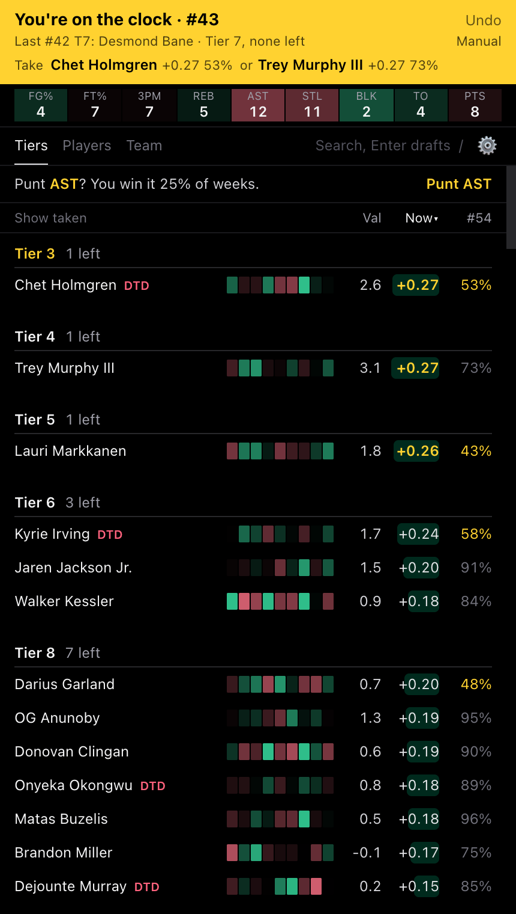
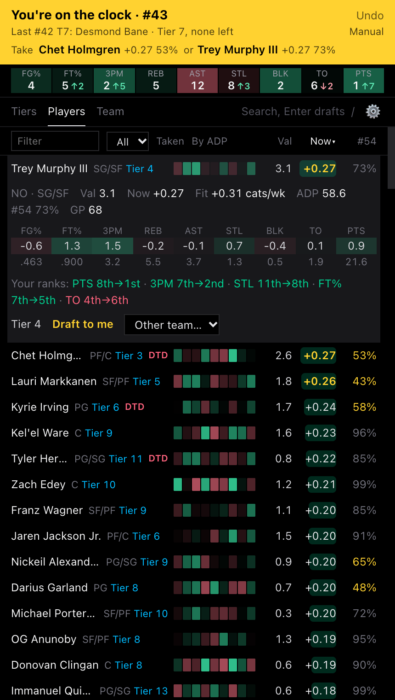
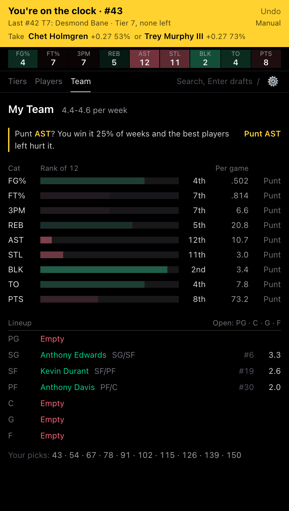

# On the Clock

Forked from [clayclark/BucketList](https://github.com/clayclark/BucketList) by Clay Clark, adapted to draft from imported Hashtag Basketball projections and consensus rankings.

A Chrome extension for ESPN 9-cat H2H fantasy basketball drafts (any Chromium browser). It sits in the side panel next to ESPN's draft room, follows every pick, and tells you who to take: your own rankings, valued with your own projections, against who will still be there at your next pick.

| On the clock | Player detail | Team |
|---|---|---|
|  |  |  |
| The Take line names the best two picks. | Drafting him moves you from 8th to 1st in points. | Where you rank in each category, and what to punt. |

## Install

```sh
pnpm install
pnpm build
```

1. Open `chrome://extensions` and turn on **Developer mode**.
2. **Load unpacked** and pick the `dist` folder.
3. Log in to espn.com in the same browser, then click the toolbar icon to open the panel. `⤢` opens it in a full tab.

After code changes, run `pnpm build` and hit reload on the extensions page.

## Set up

Open Setup (`⚙`). The top shows whether you're ready, and Tiers shows a banner until you are.

- **Projections**: your Hashtag Basketball projections CSV, exported with Z Score off.
- **Rankings**: your consensus rankings CSV (Rank, Player, Avg rank). It's split into tiers wherever Avg rank jumps by 2 or more, 3 to 12 players each.
- **League ID**: the `leagueId=` number in your ESPN league's URL. Your team is found from your login.

## Draft night

1. **Join ESPN's draft room and keep it open.** Picks come from the room's live feed, because ESPN's league API doesn't update during a draft. Joining late or reloading is fine. The extension only listens to the room; it never changes ESPN's page.
2. Read the **Take** line under the clock: the best two players for your upcoming pick by Now, with the chance each would still be there at the pick after. Click a name for his details.
3. Take a punt when Tiers suggests one, or set punts in **Team**.

Each league keeps its own punts, so a mock draft's punts don't follow you into your real one. Setup → **Start new draft** clears them by hand. ESPN's practice drafts work the same way, so a mock is a full rehearsal.

## Reading a row

| | What it means |
|---|---|
| **Heat strip** | 9 cells, one per category. Green helps, red hurts, brighter is stronger. |
| **Val** | His value from your projections: a z-score total across your non-punted categories, against the top `teams × roster` players. |
| **Now** | What taking him adds over this pick and your next: his fit for your roster, less what you'd likely get from him or someone as good next time. Amber marks your top 3. From your third pick, lists sort by it. |
| **%** | The chance he's still at your following pick if you pass on him at your upcoming one. |

Tiers lists your rankings in order until your third pick, then by Now within each tier. Click a column header to sort by it, and again to go back to your order. **Players** lists everyone, with search and position filters. **Team** has the punt advisor, your category ranks with punt toggles, every team's rank in each category, and your lineup.

## Where the numbers come from

- **Projections**: your Hashtag CSV. Players missing from it use ESPN's projections.
- **ADP**: ESPN and Fantrax, with ESPN counting double because your league drafts from its board. A player off ESPN's board counts as pick 150 on ESPN's side (or Fantrax's ADP if later), since an ESPN room mostly won't take him sooner. ESPN alone if Fantrax fails to load.
- **Chance he lasts**: an S-curve around his ADP, then scaled so the expected number of players taken between your picks matches the picks other teams actually make.
- **Category swings**: Josh Lloyd's [2025-26 consistency study](https://joshlloydfantasy.com/research/fantasy-basketball-consistency-study/). A lead in a steady category (rebounds, points) counts as more likely to win the week than the same lead in a streaky one (steals, blocks).
- **Picks**: the draft room's live feed, placed on the room's own pick order (traded picks, third-round reversal, or a plain snake in a mock) with keepers at their reserved picks. Turn sync off in Setup to enter picks by hand (search + Enter, Cmd+Z to undo).

## Dev

`pnpm dev` runs the same UI at http://localhost:5173. To reach a private league there, put `ESPN_S2` and `ESPN_SWID` (your espn.com cookies) in `.env.local`; the dev server proxies them. They never reach the built extension.

`pnpm test`, `pnpm lint` and `pnpm build` should all pass before a merge.

## License

MIT. Not affiliated with or endorsed by ESPN, Fantrax or Hashtag Basketball.
